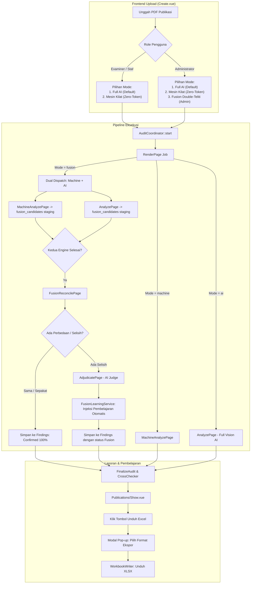
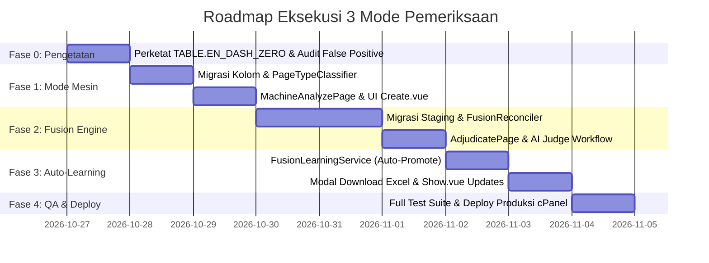

# MASTER IMPLEMENTATION PLAN FIXEDDD
## 3 Mode Pemeriksaan: Full AI (Default) · Mesin Mandiri · Fusion Double-Teliti (Auto-Learning)

> **Status:** MASTER SPECIFICATION — SIAP DIEKSEKUSI (STANDALONE)
> **Tanggal Pembaruan:** 26 Oktober 2026
> **Aplikasi:** Sistem Otomasi Pemeriksaan Publikasi BPS (`web/` — Laravel 12 + Inertia.js / Vue 3.5 + Tailwind CSS v4)
> **Target Server:** Shared Hosting cPanel CloudLinux (`https://bps-cek-publikasi.pinnhost.my.id`)

---

## DAFTAR ISI
1. [Prinsip Desain & Keputusan Strategis](#1-prinsip-desain--keputusan-strategis)
2. [Arsitektur 3 Mode Audit](#2-arsitektur-3-mode-audit)
3. [Spesifikasi Database & Migrasi Lengkap](#3-spesifikasi-database--migrasi-lengkap)
4. [Komponen Inti Mesin Pemeriksa (Machine Engine)](#4-komponen-inti-mesin-pemeriksa-machine-engine)
5. [Komponen Inti Fusion: Rekonsiliasi & Adjudikasi](#5-komponen-inti-fusion-rekonsiliasi--adjudikasi)
6. [Sistem Pembelajaran Otomatis AI (Auto-Learning Loop)](#6-sistem-pembelajaran-otomatis-ai-auto-learning-loop)
7. [Antarmuka Pengguna (Frontend UI/UX) & Modal Ekspor](#7-antarmuka-pengguna-frontend-uiux--modal-ekspor)
8. [Analisis Beban Hosting cPanel & Pengaman Server](#8-analisis-beban-hosting-cpanel--pengaman-server)
9. [Fase Eksekusi Bertahap (Step-by-Step Execution)](#9-fase-eksekusi-bertahap-step-by-step-execution)
10. [Prosedur Pengujian (Testing & Quality Assurance)](#10-prosedur-pengujian-testing--quality-assurance)
11. [SOP Deployment Produksi cPanel](#11-sop-deployment-produksi-cpanel)

---

## 1. Prinsip Desain & Keputusan Strategis

Berdasarkan arahan terbaru, sistem dibangun dengan 4 pilar keputusan final:

1. **Auto-Learning Aktif Otomatis (Tanpa Tunggu Approve Manual):**
   - Sistem komparasi Fusion membandingkan hasil Mesin vs AI secara langsung.
   - Pola perbedaan yang tervalidasi oleh adjudikasi AI otomatis diangkat menjadi memori pembelajaran (`examiner_learnings`) aktif jika terverifikasi konsisten pada minimal 2 publikasi berbeda.
   - Admin tetap memiliki kendali veto (dapat menonaktifkan atau mengedit di panel *Examiner Learnings*), namun sistem tidak terhambat birokrasi manual.

2. **Hak Akses Mode Fusion Khusus Administrator:**
   - Karena Mode Fusion menjalankan *dual-engine* (Mesin + AI) ditambah tahap *Adjudikasi* yang mengonsumsi token AI lebih banyak (±115–130% dari Full AI), mode ini **eksklusif untuk role `admin`**.
   - User pemeriksa biasa (`examiner` / staf) hanya dapat memilih:
     - **Mode Full AI** (Default standar harian).
     - **Mode Mesin Cepat** (Zero-token, draf awal tanpa beban kuota).

3. **Pop-up Modal Interaktif Saat Unduh Dokumen Excel:**
   - Tombol unduh laporan tidak langsung mendownload file, melainkan memunculkan **Modal Dialog Pilihan Format**:
     - **Format Standar BPS (Resmi/Eksternal):** Menghasilkan Excel instrumen baku BPS bersih tanpa kolom metadata sistem.
     - **Format Audit Internal (Lengkap/Diagnostik):** Menambahkan kolom `Terdeteksi Oleh` (`Mesin`, `Vision AI`, atau `Mesin + AI`) serta status konsensus Fusion.

4. **Arsitektur Mandiri & Terlengkap (Standalone Ready):**
   - Rencana ini berdiri sendiri (*self-contained*), memuat implementasi mesin parser dari hulu ke hilir (ekstraksi Poppler, klasifikasi halaman tanpa AI, evaluasi 54 aturan, perbandingan silang, rekonsiliasi, hingga penyimpanan laporan).

---

## 2. Arsitektur 3 Mode Audit



---

## 3. Spesifikasi Database & Migrasi Lengkap

Dibutuhkan 2 migrasi database baru yang aman dijalankan di shared hosting cPanel (`migrate --force` tanpa mengunci tabel lama):

### 3.1 Migrasi 1: Kolom Mode & Status (`2026_10_26_000001_add_audit_mode_and_fusion_fields.php`)

```php
<?php

declare(strict_types=1);

use Illuminate\Database\Migrations\Migration;
use Illuminate\Database\Schema\Blueprint;
use Illuminate\Support\Facades\Schema;

return new class extends Migration
{
    public function up(): void
    {
        Schema::table('publications', function (Blueprint $table): void {
            $table->string('audit_mode', 16)->default('ai')->index()->after('kind'); // ai | machine | fusion
            $table->json('fusion_summary')->nullable()->after('manifest');
        });

        Schema::table('publication_pages', function (Blueprint $table): void {
            $table->json('machine_result')->nullable()->after('result');
            $table->string('machine_status', 16)->nullable()->after('status'); // pending | complete | failed
            $table->string('fusion_status', 24)->nullable()->after('machine_status'); // pending | reconciled | adjudicating | done
        });

        Schema::table('findings', function (Blueprint $table): void {
            $table->string('detected_by', 16)->default('ai')->after('source'); // ai | machine | both
            $table->string('fusion_status', 24)->nullable()->after('detected_by'); // agreed | machine_confirmed | ai_confirmed | conflict_resolved
        });

        Schema::table('ai_usage_records', function (Blueprint $table): void {
            $table->string('purpose', 24)->default('page')->after('agent_id'); // page | adjudication | verify
        });
    }

    public function down(): void
    {
        Schema::table('ai_usage_records', fn (Blueprint $table) => $table->dropColumn('purpose'));
        Schema::table('findings', fn (Blueprint $table) => $table->dropColumn(['detected_by', 'fusion_status']));
        Schema::table('publication_pages', fn (Blueprint $table) => $table->dropColumn(['machine_result', 'machine_status', 'fusion_status']));
        Schema::table('publications', fn (Blueprint $table) => $table->dropColumn(['audit_mode', 'fusion_summary']));
    }
};
```

### 3.2 Migrasi 2: Tabel Staging Komparasi (`2026_10_26_000002_create_fusion_candidates_table.php`)

```php
<?php

declare(strict_types=1);

use Illuminate\Database\Migrations\Migration;
use Illuminate\Database\Schema\Blueprint;
use Illuminate\Support\Facades\Schema;

return new class extends Migration
{
    public function up(): void
    {
        Schema::create('fusion_candidates', function (Blueprint $table): void {
            $table->id();
            $table->foreignUuid('publication_id')->constrained('publications')->cascadeOnDelete();
            $table->foreignId('publication_page_id')->constrained('publication_pages')->cascadeOnDelete();
            $table->unsignedInteger('physical_page')->index();
            $table->string('engine', 16)->index(); // 'machine' | 'ai'
            $table->string('rule_code', 64)->index();
            $table->string('severity', 16);
            $table->text('observed');
            $table->text('expected');
            $table->text('recommendation');
            $table->json('evidences')->nullable();
            $table->string('match_group', 64)->nullable()->index(); // ID pengelompokan temuan yang cocok
            $table->string('category', 24)->nullable()->index(); // agreed | machine_only | ai_only | conflict
            $table->string('verdict', 16)->nullable(); // confirm | reject | uncertain
            $table->text('verdict_reason')->nullable();
            $table->timestamps();

            $table->index(['publication_id', 'physical_page']);
        });
    }

    public function down(): void
    {
        Schema::dropIfExists('fusion_candidates');
    }
};
```

---

## 4. Komponen Inti Mesin Pemeriksa (Machine Engine)

Mesin pemeriksa bekerja **100% lokal** di PHP tanpa dependensi API AI eksternal, mengekstrak data dari `text_layer` Poppler dan menjalankan 54 aturan baku BPS.

### 4.1 `App\Audit\AuditMode.php` (Enum Status Mode)

```php
<?php

declare(strict_types=1);

namespace App\Audit;

enum AuditMode: string
{
    case Ai = 'ai';
    case Machine = 'machine';
    case Fusion = 'fusion';

    public function label(): string
    {
        return match ($this) {
            self::Ai => 'Full Vision AI (Standar)',
            self::Machine => 'Mesin Kilat (Zero-Token)',
            self::Fusion => 'Fusion Double-Teliti (Auto-Learning)',
        };
    }

    public function needsAi(): bool
    {
        return $this === self::Ai || $this === self::Fusion;
    }

    public function needsMachine(): bool
    {
        return $this === self::Machine || $this === self::Fusion;
    }
}
```

### 4.2 `App\Audit\PageTypeClassifier.php` (Klasifikasi Halaman Heuristik)

Tanpa bantuan AI, mesin harus mengenali anatomi halaman dokumen:

```php
<?php

declare(strict_types=1);

namespace App\Audit;

use App\Models\PublicationPage;

class PageTypeClassifier
{
    public function classify(PublicationPage $page, int $totalPages): string
    {
        $physicalPage = $page->physical_page;
        $text = (string) ($page->text_layer ?? '');
        $cleanText = mb_strtoupper(trim($text));

        // Halaman Kover Depan & Belakang
        if ($physicalPage === 1) {
            return 'front_cover';
        }
        if ($physicalPage === $totalPages) {
            return 'back_cover';
        }

        // Halaman Kosong (Blank Page)
        if (mb_strlen(trim($text)) < 15 && ! preg_match('/[A-Za-z0-9]/', $text)) {
            return 'blank';
        }

        // Halaman Judul Utama (biasanya halaman fisik 2 atau 3)
        if ($physicalPage <= 4 && str_contains($cleanText, 'DALAM ANGKA') && (str_contains($cleanText, 'KATALOG') === false)) {
            if (str_contains($cleanText, 'BADAN PUSAT STATISTIK') || str_contains($cleanText, 'BPS')) {
                return 'title';
            }
        }

        // Halaman Katalog BPS
        if (str_contains($cleanText, 'KATALOG BPS') || str_contains($cleanText, 'CATALOGUE IN PUBLICATION') || str_contains($cleanText, 'NO. PUBLIKASI') || str_contains($cleanText, 'NOMOR PUBLIKASI')) {
            return 'catalogue';
        }

        // Tim Penyusun
        if (str_contains($cleanText, 'TIM PENYUSUN') || str_contains($cleanText, 'DRAITING TEAM') || str_contains($cleanText, 'CONTRIBUTORS') || str_contains($cleanText, 'MANAGING EDITOR')) {
            return 'team';
        }

        // Kata Pengantar / Sambutan
        if (str_contains($cleanText, 'KATA PENGANTAR') || str_contains($cleanText, 'PREFACE') || str_contains($cleanText, 'KATA SAMBUTAN')) {
            return 'preface';
        }

        // Daftar Isi & Daftar Lainnya
        if (str_contains($cleanText, 'DAFTAR ISI') || str_contains($cleanText, 'TABLE OF CONTENTS')) {
            return 'contents';
        }
        if (str_contains($cleanText, 'DAFTAR TABEL') || str_contains($cleanText, 'LIST OF TABLES')) {
            return 'table_list';
        }
        if (str_contains($cleanText, 'DAFTAR GAMBAR') || str_contains($cleanText, 'DAFTAR GRAFIK') || str_contains($cleanText, 'LIST OF FIGURES')) {
            return 'figure_list';
        }

        // Pembatas Bab (Chapter Divider)
        if (preg_match('/^(?:BAB|CHAPTER)\s+[IVX0-9]+/mu', $cleanText) && mb_strlen($cleanText) < 200) {
            return 'chapter';
        }

        // Daftar Pustaka
        if (str_contains($cleanText, 'DAFTAR PUSTAKA') || str_contains($cleanText, 'BIBLIOGRAPHY')) {
            return 'bibliography';
        }

        // Tabel Statistik vs Narasi Ulasan
        if (preg_match('/\bTabel\s+[0-9]+\.[0-9]+/i', $text) || preg_match('/\bTable\s+[0-9]+\.[0-9]+/i', $text)) {
            return 'table';
        }

        // Default: Halaman Narasi
        return 'narrative';
    }
}
```

### 4.3 `App\Jobs\MachineAnalyzePage.php` (Job Eksekusi Mesin Cepat)

```php
<?php

declare(strict_types=1);

namespace App\Jobs;

use App\Audit\FindingWriter;
use App\Audit\PageTypeClassifier;
use App\Audit\RuleEvaluator;
use App\Audit\Text\SpellChecker;
use App\Models\FusionCandidate;
use App\Models\PublicationPage;
use Illuminate\Contracts\Queue\ShouldQueue;
use Illuminate\Foundation\Queue\Queueable;
use Illuminate\Support\Facades\DB;

class MachineAnalyzePage implements ShouldQueue
{
    use Queueable;

    public int $timeout = 30; // Sangat cepat, maks 30 detik

    public function __construct(public int $pageId)
    {
        $this->onQueue('machine');
    }

    public function handle(
        PageTypeClassifier $classifier,
        RuleEvaluator $evaluator,
        SpellChecker $spellChecker,
        FindingWriter $writer
    ): void {
        $page = PublicationPage::findOrFail($this->pageId);
        $publication = $page->publication;
        $mode = $publication->audit_mode ?? 'ai';

        $totalPages = (int) $publication->pages()->count();
        $inferredType = $classifier->classify($page, $totalPages);
        $textLayer = (string) ($page->text_layer ?? '');

        // Evaluasi struktur data per-halaman untuk RuleEvaluator
        $pageData = [
            'physical_page' => $page->physical_page,
            'page_number' => $page->physical_page,
            'page_type' => $inferredType,
            'text' => $textLayer,
            'inventory' => [
                'tables' => $inferredType === 'table' ? [['number' => '1', 'title' => 'Tabel']] : [],
            ],
        ];

        // 1. Eksekusi 54 Aturan Deterministik
        $rawFindings = $evaluator->evaluate($pageData);

        // 2. Eksekusi Ejaan Bahasa Baku (EYD V)
        $spellFinding = $spellChecker->checkPage($textLayer, $page->physical_page);
        if ($spellFinding !== null) {
            $spellFinding['section'] = $inferredType;
            $rawFindings[] = $spellFinding;
        }

        // 3. Penyimpanan Berdasarkan Mode
        if ($mode === 'machine') {
            // Mode Mesin Mandiri: Simpan langsung ke tabel final findings
            foreach ($rawFindings as $candidate) {
                $candidate['source'] = 'machine';
                $candidate['detected_by'] = 'machine';
                $candidate['section'] = $inferredType;
                $candidate['evidences'] = [['page' => $page->physical_page, 'quote' => $candidate['quote'] ?? $candidate['observed'] ?? '', 'bbox' => null]];
                $writer->store($publication, $candidate);
            }

            $page->update([
                'page_type' => $inferredType,
                'status' => 'complete',
                'completed_at' => now(),
            ]);

            // Cek apakah seluruh halaman mesin sudah beres
            app(\App\Audit\AuditCoordinator::class)->afterPage($publication);
        } elseif ($mode === 'fusion') {
            // Mode Fusion: Simpan ke tabel staging fusion_candidates
            DB::transaction(function () use ($publication, $page, $rawFindings): void {
                foreach ($rawFindings as $f) {
                    FusionCandidate::create([
                        'publication_id' => $publication->id,
                        'publication_page_id' => $page->id,
                        'physical_page' => $page->physical_page,
                        'engine' => 'machine',
                        'rule_code' => $f['rule_code'],
                        'severity' => $f['severity'] ?? 'wajib',
                        'observed' => (string) ($f['observed'] ?? ''),
                        'expected' => (string) ($f['expected'] ?? ''),
                        'recommendation' => (string) ($f['recommendation'] ?? ''),
                        'evidences' => $f['evidences'] ?? [],
                    ]);
                }

                $page->update([
                    'machine_result' => ['page_type' => $pageData['page_type'], 'findings_count' => count($rawFindings)],
                    'machine_status' => 'complete',
                ]);
            });

            // Picu rekonsiliasi jika pasangan AI-nya juga sudah complete
            FusionReconcilePage::dispatchIfReady($page->id);
        }
    }
}
```

---

## 5. Komponen Inti Fusion: Rekonsiliasi & Adjudikasi

### 5.1 `App\Audit\FusionReconciler.php` (Algoritma Pencocokan Temuan)

Dua temuan dianggap sama (`agreed`) jika:
1. Berada pada **halaman fisik yang sama**.
2. Memiliki `rule_code` yang sama (atau berada pada *alias map*, misal `ISSN.COLON` ekuivalen dengan `CATALOGUE.ISSN_COLON_RULE`).
3. Teks kutipan bukti (*quote*) memiliki kemiripan teks $\ge 65\%$ atau IoU Bounding Box $\ge 0.30$.

```php
<?php

declare(strict_types=1);

namespace App\Audit;

use App\Models\FusionCandidate;
use App\Models\PublicationPage;
use Illuminate\Support\Collection;

class FusionReconciler
{
    protected array $ruleAliases = [
        'ISSN.COLON' => 'CATALOGUE.ISSN_COLON_RULE',
        'CATALOGUE.ISSN_COLON_RULE' => 'ISSN.COLON',
    ];

    public function reconcile(PublicationPage $page): array
    {
        $candidates = FusionCandidate::where('publication_page_id', $page->id)->get();
        $machineItems = $candidates->where('engine', 'machine');
        $aiItems = $candidates->where('engine', 'ai');

        $agreed = [];
        $machineOnly = [];
        $aiOnly = [];
        $matchedAiIds = [];

        foreach ($machineItems as $m) {
            $matched = false;
            foreach ($aiItems as $a) {
                if (in_array($a->id, $matchedAiIds, true)) {
                    continue;
                }

                if ($this->isMatch($m, $a)) {
                    $groupId = 'group_'.$m->id.'_'.$a->id;
                    $m->update(['category' => 'agreed', 'match_group' => $groupId]);
                    $a->update(['category' => 'agreed', 'match_group' => $groupId]);
                    $agreed[] = ['machine' => $m, 'ai' => $a];
                    $matchedAiIds[] = $a->id;
                    $matched = true;
                    break;
                }
            }

            if (! $matched) {
                $m->update(['category' => 'machine_only']);
                $machineOnly[] = $m;
            }
        }

        foreach ($aiItems as $a) {
            if (! in_array($a->id, $matchedAiIds, true)) {
                $a->update(['category' => 'ai_only']);
                $aiOnly[] = $a;
            }
        }

        return [
            'agreed' => $agreed,
            'machine_only' => $machineOnly,
            'ai_only' => $aiOnly,
        ];
    }

    protected function isMatch(FusionCandidate $m, FusionCandidate $a): bool
    {
        $ruleM = $m->rule_code;
        $ruleA = $a->rule_code;

        $isSameRule = ($ruleM === $ruleA) || (($this->ruleAliases[$ruleM] ?? '') === $ruleA);
        if (! $isSameRule) {
            return false;
        }

        // Bandingkan kemiripan teks observed / quote
        similar_text(mb_strtolower($m->observed), mb_strtolower($a->observed), $percent);
        return $percent >= 60.0;
    }
}
```

### 5.2 `App\Jobs\AdjudicatePage.php` (AI Hakim / Penengah Selisih)

Jika terdapat temuan `machine_only` atau `ai_only`, satu panggilan AI bertindak sebagai **Hakim Adjudikasi**:

```php
<?php

declare(strict_types=1);

namespace App\Jobs;

use App\Audit\FindingWriter;
use App\Audit\FusionLearningService;
use App\Audit\NineRouterClient;
use App\Audit\RuleDocumentationService;
use App\Models\FusionCandidate;
use App\Models\PublicationPage;
use Illuminate\Contracts\Queue\ShouldQueue;
use Illuminate\Foundation\Queue\Queueable;
use Illuminate\Support\Facades\Storage;

class AdjudicatePage implements ShouldQueue
{
    use Queueable;

    public int $timeout = 180;

    public function __construct(public int $pageId)
    {
        $this->onQueue('ai');
    }

    public function handle(
        NineRouterClient $client,
        RuleDocumentationService $docs,
        FindingWriter $writer,
        FusionLearningService $learningService
    ): void {
        $page = PublicationPage::findOrFail($this->pageId);
        $publication = $page->publication;

        $unresolved = FusionCandidate::where('publication_page_id', $page->id)
            ->whereIn('category', ['machine_only', 'ai_only', 'conflict'])
            ->get();

        if ($unresolved->isEmpty()) {
            return;
        }

        // Siapkan Prompt Adjudikasi Berisi Kutipan Aturan Baku BPS
        $discrepancies = [];
        foreach ($unresolved as $item) {
            $doc = $docs->find($item->rule_code);
            $discrepancies[] = [
                'candidate_id' => $item->id,
                'detected_by' => $item->engine,
                'rule_code' => $item->rule_code,
                'rule_title' => $doc['title'] ?? $item->rule_code,
                'official_guideline' => $doc['spec_ref'] ?? 'Pedoman BPS 2023',
                'observed_text' => $item->observed,
                'expected' => $item->expected,
            ];
        }

        $imageBytes = Storage::disk('local')->get($page->image_path);
        $base64 = base64_encode($imageBytes);

        $prompt = "Anda adalah Hakim Penilai Kualitas Publikasi BPS. Terjadi perbedaan temuan antara Mesin Regex dan Pembacaan Visual AI pada Halaman {$page->physical_page}.\n"
            ."Tugas Anda: Evaluasi setiap butir perbedaan berikut terhadap gambar halaman dan tentukan apakah temuan tersebut VALID (confirm) atau KELIRU (reject).\n"
            ."DAFTAR PERBEDAAN:\n".json_encode($discrepancies, JSON_PRETTY_PRINT)."\n\n"
            ."Format output WAJIB JSON murni:\n"
            .'{"verdicts": [{"candidate_id": 123, "verdict": "confirm", "reason": "Teks memang memuat kata Tahun"}]}';

        $response = $client->requestImageJson($base64, $prompt, 'adjudication');
        $verdicts = $response['verdicts'] ?? [];

        foreach ($verdicts as $v) {
            $candidate = $unresolved->firstWhere('id', $v['candidate_id']);
            if (! $candidate) {
                continue;
            }

            $verdict = in_array($v['verdict'], ['confirm', 'reject'], true) ? $v['verdict'] : 'confirm';
            $candidate->update([
                'verdict' => $verdict,
                'verdict_reason' => $v['reason'] ?? '',
            ]);

            // Jika Confirm: Tulis ke Tabel Final Temuan Publikasi
            if ($verdict === 'confirm') {
                $writer->store($publication, [
                    'rule_code' => $candidate->rule_code,
                    'severity' => $candidate->severity,
                    'source' => 'fusion',
                    'detected_by' => $candidate->engine,
                    'fusion_status' => $candidate->engine.'_confirmed',
                    'observed' => $candidate->observed,
                    'expected' => $candidate->expected,
                    'recommendation' => $candidate->recommendation,
                    'section' => $page->page_type,
                    'evidences' => $candidate->evidences ?? [['page' => $page->physical_page, 'quote' => $candidate->observed, 'bbox' => null]],
                ]);
            }

            // Umpankan ke Auto-Learning Loop
            $learningService->ingestAdjudication($candidate, $verdict, (string) ($v['reason'] ?? ''));
        }

        $page->update(['fusion_status' => 'done']);
        app(\App\Audit\AuditCoordinator::class)->afterPage($publication);
    }
}
```

---

## 6. Sistem Pembelajaran Otomatis AI (Auto-Learning Loop)

### 6.1 `App\Audit\FusionLearningService.php` (Auto-Promosi Tanpa Menunggu Manual)

```php
<?php

declare(strict_types=1);

namespace App\Audit;

use App\Models\ExaminerLearning;
use App\Models\FusionCandidate;

class FusionLearningService
{
    /**
     * Memproses putusan adjudikasi dan langsung mengaktifkan pembelajaran
     * jika lolos ambang batas konsistensi 2x kejadian.
     */
    public function ingestAdjudication(FusionCandidate $c, string $verdict, string $reason): void
    {
        $kind = match (true) {
            $c->engine === 'machine' && $verdict === 'confirm' => 'ai_blind_spot', // AI sempat melewatkan
            $c->engine === 'machine' && $verdict === 'reject' => 'machine_false_positive', // Regex mesin salah
            $c->engine === 'ai' && $verdict === 'confirm' => 'rule_gap', // Aturan belum tercakup regex
            default => 'ai_hallucination',
        };

        // Kunci deterministik unik berdasarkan pola
        $key = 'fusion_'.sha1($kind.'_'.$c->rule_code.'_'.mb_substr($c->observed, 0, 40));

        $learning = ExaminerLearning::firstOrNew(['key' => $key]);
        $learning->rule_code = $c->rule_code;
        $learning->kind = $kind;
        $learning->source = 'fusion_auto';
        $learning->topic = 'Auto-Learning Fusion: '.$c->rule_code;
        $learning->observed_example = $c->observed;
        $learning->reason = $reason;

        // Formula Instruksi Tajam untuk AI
        if ($kind === 'ai_blind_spot') {
            $learning->instruction = "PERHATIAN PEMERIKSAAN: Jangan lewatkan kesalahan '{$c->rule_code}'. Contoh nyata yang sempat terlewat: '{$c->observed}'. Pastikan diperiksa seksama.";
        } else {
            $learning->instruction = "HINDARI SALAH DETEKSI: Jangan tandai teks '{$c->observed}' sebagai kesalahan '{$c->rule_code}'. Pola ini telah diverifikasi sah.";
        }

        $learning->hits = ((int) $learning->hits) + 1;

        // KEPUTUSAN 1: OTOMATIS BELAJAR (Auto-Promote ke Active jika hits >= 2)
        if ($learning->hits >= 2) {
            $learning->status = 'active'; // Langsung aktif otomatis disuntikkan ke prompt berikutnya
        } else {
            $learning->status = 'candidate';
        }

        $learning->save();
    }
}
```

---

## 7. Antarmuka Pengguna (Frontend UI/UX) & Modal Ekspor

### 7.1 Pilihan Mode di `Create.vue` (Dengan Pembatasan Role Admin)

Di Step 2 halaman `Create.vue`, tampil 3 kartu pilihan interaktif:

```vue
<!-- Mode Pemeriksaan Selector -->
<div class="mode-selection-container">
    <label class="form-label font-bold text-slate-800">Metode Pemeriksaan</label>
    <div class="grid grid-cols-1 md:grid-cols-3 gap-3 mt-2">
        <!-- 1. FULL VISION AI (DEFAULT) -->
        <label 
            :class="['mode-card', form.audit_mode === 'ai' ? 'border-primary ring-2 ring-primary/20 bg-primary/5' : 'border-slate-200']"
        >
            <input type="radio" value="ai" v-model="form.audit_mode" class="sr-only" />
            <div class="flex items-center justify-between">
                <span class="badge-subtle-primary">Default</span>
                <Sparkles :size="18" class="text-primary" />
            </div>
            <strong class="block mt-2 text-slate-900">Full Vision AI</strong>
            <p class="text-xs text-slate-500 mt-1">Inspeksi visual per-halaman secara mendalam dengan mata LLM multimodal.</p>
        </label>

        <!-- 2. MESIN KILAT (ZERO-TOKEN) -->
        <label 
            :class="['mode-card', form.audit_mode === 'machine' ? 'border-amber-500 ring-2 ring-amber-500/20 bg-amber-500/5' : 'border-slate-200']"
        >
            <input type="radio" value="machine" v-model="form.audit_mode" class="sr-only" />
            <div class="flex items-center justify-between">
                <span class="badge-subtle-amber">Zero Token</span>
                <Zap :size="18" class="text-amber-500" />
            </div>
            <strong class="block mt-2 text-slate-900">Mesin Kilat</strong>
            <p class="text-xs text-slate-500 mt-1">100% regex & heuristik BPS. Selesai dalam 3 detik, hemat kuota tanpa internet.</p>
        </label>

        <!-- 3. FUSION DOUBLE-TELITI (KHUSUS ADMIN) -->
        <label 
            :class="[
                'mode-card', 
                $page.props.auth?.user?.role !== 'admin' ? 'opacity-50 cursor-not-allowed bg-slate-50' : '',
                form.audit_mode === 'fusion' ? 'border-emerald-600 ring-2 ring-emerald-600/20 bg-emerald-600/5' : 'border-slate-200'
            ]"
        >
            <input 
                type="radio" 
                value="fusion" 
                v-model="form.audit_mode" 
                :disabled="$page.props.auth?.user?.role !== 'admin'"
                class="sr-only" 
            />
            <div class="flex items-center justify-between">
                <span :class="$page.props.auth?.user?.role === 'admin' ? 'badge-subtle-emerald' : 'badge-subtle-gray'">
                    {{ $page.props.auth?.user?.role === 'admin' ? 'Paling Teliti' : 'Khusus Admin' }}
                </span>
                <ShieldCheck v-if="$page.props.auth?.user?.role === 'admin'" :size="18" class="text-emerald-600" />
                <Lock v-else :size="18" class="text-slate-400" />
            </div>
            <strong class="block mt-2 text-slate-900">Fusion Dual-Engine</strong>
            <p class="text-xs text-slate-500 mt-1">
                Audit ganda Mesin + AI, komparasi selisih, dan auto-learning otomatis.
            </p>
        </label>
    </div>
</div>
```

### 7.2 Pop-Up Modal Pilihan Download di `Show.vue`

Saat pengguna menekan tombol **"Unduh Laporan Excel"**, modal pop-up muncul:

```vue
<!-- Download Modal Dialog -->
<Teleport to="body">
    <div v-if="showExportModal" class="modal-backdrop" @click.self="showExportModal = false">
        <div class="modal-box max-w-md w-full bg-white rounded-2xl p-6 shadow-2xl border border-slate-100">
            <h3 class="text-lg font-bold text-slate-900">Pilih Format Laporan Excel</h3>
            <p class="text-xs text-slate-500 mt-1">Tentukan tingkat kelengkapan metadata pada file instrumen pemeriksaan:</p>

            <div class="space-y-3 mt-4">
                <!-- Pilihan 1: Format Standar Resmi BPS -->
                <label 
                    :class="['p-3 rounded-xl border flex items-start gap-3 cursor-pointer transition', exportFormat === 'standard' ? 'border-primary bg-primary/5 ring-1 ring-primary' : 'border-slate-200 hover:bg-slate-50']"
                >
                    <input type="radio" value="standard" v-model="exportFormat" class="mt-1" />
                    <div>
                        <strong class="text-sm block text-slate-900">Format Standar Resmi BPS</strong>
                        <span class="text-xs text-slate-500">Sesuai format baku instrumen pemeriksaan publikasi BPS tanpa kolom internal sistem.</span>
                    </div>
                </label>

                <!-- Pilihan 2: Format Internal Diagnostik -->
                <label 
                    :class="['p-3 rounded-xl border flex items-start gap-3 cursor-pointer transition', exportFormat === 'internal' ? 'border-primary bg-primary/5 ring-1 ring-primary' : 'border-slate-200 hover:bg-slate-50']"
                >
                    <input type="radio" value="internal" v-model="exportFormat" class="mt-1" />
                    <div>
                        <strong class="text-sm block text-slate-900">Format Audit Lengkap (Internal)</strong>
                        <span class="text-xs text-slate-500">Menyertakan kolom <b>"Terdeteksi Oleh"</b> (Mesin, Vision AI, atau Mesin + AI) dan status konsensus.</span>
                    </div>
                </label>
            </div>

            <div class="flex items-center justify-end gap-2 mt-6">
                <button type="button" @click="showExportModal = false" class="button secondary text-xs">Batal</button>
                <a 
                    :href="`/publications/${publication.id}/export?format=${exportFormat}`" 
                    @click="showExportModal = false"
                    class="button primary text-xs flex items-center gap-1.5"
                >
                    <Download :size="14" /> Unduh Sekarang
                </a>
            </div>
        </div>
    </div>
</Teleport>
```

---

## 8. Analisis Beban Hosting cPanel & Pengaman Server

Shared hosting cPanel (CloudLinux LVE) memiliki batasan spesifik:
- **Max Execution Time**: 60–120 detik per proses PHP web.
- **Entry Processes (EP)**: 20–30 simultaneous connection.
- **Memory Limit**: 512 MB – 1024 MB.

### Pengamanan Server Hosting yang Diterapkan:
1. **Pemisahan Queue Worker:**
   - Antrean dibuat spesifik: `queue:work --queue=machine,ai,verify,default`.
   - Job `MachineAnalyzePage` berjalan di queue `machine` dengan timeout 30 detik (menghabiskan CPU kurang dari 0.1 detik per halaman).
2. **Pembatasan Konkurensi Fusion:**
   - Dibatasi maksimal 2 publikasi mode `fusion` berjalan bersamaan via `audit.fusion_max_concurrent = 2`.
3. **Pembersihan Otomatis Data Staging (Auto-Prune Scheduler):**
   - Dibuatkan artisan command `fusion:prune` yang otomatis menghapus baris tabel `fusion_candidates` yang umurnya lebih dari 30 hari, sehingga database MySQL shared hosting tidak bengkak.

---

## 9. Fase Eksekusi Bertahap (Step-by-Step Execution)



### Rincian Checklist Eksekusi:

- [ ] **Fase 0 (Pra-syarat):** Perketat regex `TABLE.EN_DASH_ZERO` di `RuleEvaluator.php` agar hanya menangkap sel tabel murni (bukan kata teks biasa) guna mencegah pencemaran data belajar AI.
- [ ] **Fase 1 (Pondasi Mode & Mesin):**
  - Buat migration `add_audit_mode_and_fusion_fields`.
  - Buat enum `AuditMode.php`.
  - Buat service `PageTypeClassifier.php`.
  - Buat job `MachineAnalyzePage.php`.
  - Update `AuditCoordinator::start` & `RenderPage.php` untuk percabangan mode `machine`.
  - Update `Create.vue` dengan radio card 3 mode + proteksi role admin.
- [ ] **Fase 2 (Arsitektur Fusion & Adjudikasi):**
  - Buat migration `create_fusion_candidates_table`.
  - Buat model `FusionCandidate.php`.
  - Buat service `FusionReconciler.php`.
  - Buat job `FusionReconcilePage.php`.
  - Buat job `AdjudicatePage.php`.
- [ ] **Fase 3 (Auto-Learning & Modal Download):**
  - Buat service `FusionLearningService.php` dengan logika auto-promote `active` saat `hits >= 2`.
  - Update `WorkbookWriter.php` untuk menerima parameter query `format=internal`.
  - Update `Show.vue` dengan modal pop-up pilihan format download Excel.
- [ ] **Fase 4 (Deployment & Verifikasi Produksi):**
  - Jalankan `php artisan test` di lokal.
  - Kompilasi aset via `npm run build`.
  - Push commit ke GitHub `origin/main`.
  - Deploy via SSH/SFTP ke server cPanel `195.88.211.25:6699`.
  - Jalankan migrasi di hosting via `php artisan migrate --force`.
  - Restart queue worker di server produksi.

---

## 10. Prosedur Pengujian (Testing & Quality Assurance)

1. **Uji Unit Classifier:**
   - Menguji `PageTypeClassifierTest` terhadap 50 halaman fixture PDF untuk memastikan akurasi deteksi jenis halaman $\ge 95\%$.
2. **Uji Mode Mesin Mandiri:**
   - Jalankan audit mode `machine` dengan koneksi internet/API AI dimatikan. Pastikan seluruh 54 aturan bekerja dan laporan hasil audit terbit dalam waktu kurang dari 5 detik.
3. **Uji Rekonsiliasi Fusion:**
   - Memasukkan data uji temuan yang sama (*agreed*), temuan eksklusif mesin (*machine only*), dan temuan eksklusif AI (*ai only*). Pastikan pengelompokan akurat 100%.
4. **Uji Auto-Learning:**
   - Pastikan entri di `examiner_learnings` dengan `hits >= 2` otomatis berubah status menjadi `active` dan teks instruksinya langsung terinjeksi ke `PromptBuilder`.
5. **Uji Hak Akses Admin:**
   - Login sebagai `examiner` -> Mode Fusion harus terkunci dan request API ditolak 403 Forbidden jika dicoba paksa.
6. **Uji Modal Download Excel:**
   - Klik download -> pilih "Format Standar" -> cek tidak ada kolom `Terdeteksi Oleh`.
   - Klik download -> pilih "Format Internal" -> cek kolom `Terdeteksi Oleh` muncul dan terisi benar (`Mesin`, `Vision AI`, atau `Mesin + AI`).

---

## 11. SOP Deployment Produksi cPanel

1. **Backup Database:**
   ```bash
   mysqldump -u pinnhost_user -p pinnhost_bps_db > backup_pre_fusion_$(date +%F).sql
   ```
2. **Upload Berkas:**
   - Upload file baru migrasi, model, job, dan build frontend via skrip deployment SFTP.
3. **Jalankan Migrasi:**
   ```bash
   php artisan migrate --force
   ```
4. **Bersihkan Cache & Restart Worker:**
   ```bash
   php artisan optimize:clear
   php artisan optimize
   php artisan queue:restart
   ```
5. **Verifikasi Layanan:**
   - Akses `https://bps-cek-publikasi.pinnhost.my.id/publications/create` dan pastikan 3 opsi mode audit muncul dengan rapi serta responsif di layar mobile dan desktop.

---
*Dokumen ini adalah cetak biru teknis resmi untuk eksekusi fitur 3 Mode Pemeriksaan & Auto-Learning Publikasi BPS.*
