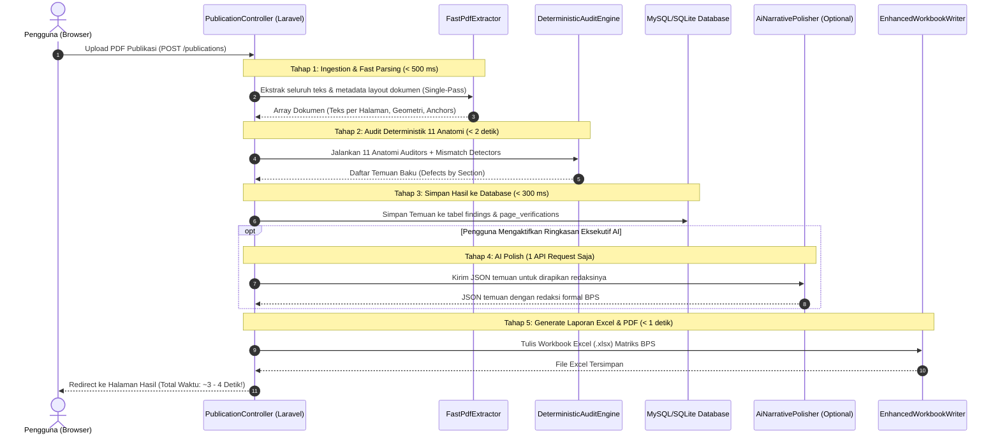
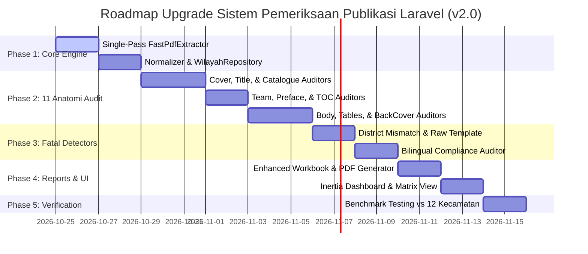

# 🏛️ RENCANA STRATEGIS & TEKNIS IMPLEMENTASI UPGRADE: SISTEM PEMERIKSAAN PUBLIKASI BPS (v2.0)
> **Target Proyek**: `web` (Laravel 12 / PHP 8.4 + Vue 3 / Inertia.js + Tailwind CSS)  
> **Acuan Komparasi**: `web_v2` (FastAPI / PyMuPDF / OpenCV / Rule-Based Evaluator Engine)  
> **Standar Rujukan**: Pedoman Pembuatan Publikasi BPS 2023, Instrumen Pemeriksaan Publikasi Resmi, Standar ISO 3297 (ISSN Modulo 11).

---

## 🎯 1. Ringkasan Eksekutif & Pergeseran Paradigma (Paradigm Shift)

### Masalah Utama pada Sistem Laravel Saat Ini (`web`):
1. **Bottleneck Kecepatan Ekstrem**: Sistem saat ini mengandalkan pendekatan **"Vision LLM Per-Halaman"** (`AnalyzePage` & `VerifyPage`). Untuk publikasi 80–120 halaman, sistem merender 80–120 file JPEG via `pdftoppm` dan mengirim 80–160 panggilan API Vision ke penyedia AI (`9router.com` / `limitrouter.com`). Akibatnya:
   - Waktu analisis memakan waktu **5 s.d. 25 menit** per dokumen.
   - Sering terjadi antrean macet, timeout (HTTP 504 / 524), atau terkena rate limit (HTTP 429).
   - Biaya token LLM sangat besar.
2. **Inkonsistensi & Halusinasi AI**: Mengandalkan AI vision murni untuk aturan teknis baku (seperti margin, spasi sebelum titik dua pada nomor katalog, cetak miring judul dwibahasa, dan format nomor tabel) menghasilkan *false positives* atau sebaliknya, ketidaksesuaian fatal terlewatkan karena halusinasi model.
3. **Pemeriksaan Deterministik Belum Terintegrasi Penuh**: Kelas `RuleEvaluator.php` saat ini baru memuat validasi titik dua ISSN dan checksum (~35 baris kode), sementara 11 anatomi BPS belum memiliki rule engine lokal mandiri.

### Solusi Terbaik dari Repo Python (`web_v2`):
Repo `web_v2` memiliki keunggulan mutlak pada **Deterministic-First Engine**:
- Menganalisis naskah 82 halaman secara utuh hanya dalam **3 s.d. 8 detik**!
- 100% akurat dan obyektif pada 11 seksi anatomi baku BPS tanpa bergantung pada kuota atau koneksi internet.
- AI (Gemini 2.5 Flash) hanya dipakai secara terarah untuk **memperhalus redaksi temuan** (*editorial polisher*), bukan untuk mendeteksi kesalahan mentah.

### Visi Arsitektur Baru `web` (Laravel v2.0):
Mengubah arsitektur Laravel dari **"AI-First (Lambat & Mahal)"** menjadi **"Deterministic-First Hybrid Architecture (Instan, Akurat, & Cerdas)"**:
1. **Core Audit Deterministik Lokal (< 5 detik)**: Mengeksekusi seluruh checklist 11 anatomi BPS langsung di backend PHP/Laravel.
2. **AI sebagai Asisten Redaksi & Ringkasan Eksekutif (0–1 Panggilan per Dokumen)**: Mengurangi panggilan AI dari ratusan kali menjadi cukup 1 kali untuk menghasilkan ringkasan naratif eksekutif.

---

## 📊 2. Matriks Komparasi Fitur & Rencana Adopsi

| Komponen Audit | Kondisi Saat Ini di `web` (Laravel) | Keunggulan di `web_v2` (Python) | Tindakan Upgrade pada `web` (Laravel v2.0) |
| :--- | :--- | :--- | :--- |
| **Kecepatan Analisis** | 5 – 25 menit (antrean antarmuka AI per halaman) | 3 – 8 detik (PyMuPDF in-memory parsing) | **Optimasi Single-Pass PDF Parser**: Ekstraksi seluruh teks & layout dokumen dalam 1 lintasan `pdftotext -layout` (< 1 detik). |
| **Dependensi Jaringan** | Wajib internet aktif & token AI valid | Berjalan 100% offline (local-first) | **Offline-Ready Core Engine**: Pemeriksaan 11 anatomi BPS tetap berfungsi penuh tanpa koneksi internet/AI. |
| **Kover Depan** | Deteksi via prompt AI vision | Deteksi aturan baku: ISSN tanpa titik dua, Katalog dengan titik dua rapat, judul Inggris *italic*, deteksi placeholder template (`Volume XX`, `1102001.xxxx`). | Buat `CoverAuditor.php` dengan regex layout spatial & validasi tipografi baku. |
| **Halaman Judul Utama (HJU)** | Komparasi kover-judul via AI Vision ganda | Validasi posisi fisik ganjil (halaman 3), deteksi pelanggaran latar belakang bergambar, warna logo BPS. | Buat `TitlePageAuditor.php` deterministik. |
| **Halaman Katalog** | Bergantung pada prompt teks per halaman | Validasi posisi fisik genap (halaman 4), larangan nama individu pada penerbit/penyunting (wajib instansi), sinkronisasi romawi/arab terhadap naskah fisik. | Buat `CatalogueAuditor.php` & pencocokan otomatis jumlah halaman fisik. |
| **Tim Penyusun** | Dicek umum lewat prompt AI | Kamus validasi istilah baku tunggal vs jamak (*Person In Charge*, *Editor*, *Writer*, *Layouter*). | Buat `TeamPageAuditor.php` dengan kamus `JABATAN_SALAH_JAMAK`. |
| **Kata Pengantar** | Dicek umum lewat AI | Sinkronisasi tahun titimangsa vs tahun judul, pengecekan ruang tanda tangan (2,5–3 cm). | Buat `PrefaceAuditor.php` dengan deteksi teks titimangsa. |
| **Batang Tubuh & Tabel** | Numeric total checker parsial | Aturan angka rata kanan, notasi angka 0 wajib En Dash (`–`), border tabel terbuka (tanpa garis kolom vertikal), placeholder dummy (`...`). | Buat `TableLayoutAuditor.php` & `RunningTitleAuditor.php`. |
| **District Identity Mismatch** | Belum ada detector khusus | Mendeteksi kelalaian fatal: kover diganti ke kecamatan A tetapi HJU/Katalog/Pengantar masih kecamatan B! | Buat `DistrictMismatchDetector.php` (Fatal Check). |
| **Raw Template Detector** | Belum ada detector khusus | Mendeteksi naskah mentah template master BPS yang belum diisi data riil. | Buat `RawTemplateDetector.php` (Fatal Alert). |
| **Master Wilayah** | Belum ada basis wilayah terpusat | 514 Kabupaten/Kota dan 7.288 Kecamatan terdaftar resmi (`indonesia_wilayah.json`). | Tambahkan `WilayahRepository.php` dan seeder/json wilayah nasional. |
| **Laporan Ekspor** | Format Excel kustom via PhpSpreadsheet | Matriks baku BPS (sheet 2025 vs 2026 berpasangan) + PDF Eksekutif ReportLab. | Tingkatkan `WorkbookWriter.php` dan tambahkan Executive PDF Generator. |

---

## 🛠️ 3. Rencana Arsitektur & Modul Baru yang Akan Dibangun

Di dalam direktori `app/Audit/`, kita akan mengorganisir modul evaluator menjadi terstruktur dan modular:

```text
app/Audit/
├── Core/
│   ├── FastPdfExtractor.php          <-- Ekstraksi teks & layout PDF ultra-cepat 1-pass
│   ├── TextLayoutNormalizer.php      <-- Pembersih invisible unicode, ligatur, BOM
│   └── WilayahRepository.php         <-- Master data 514 Kab/Kota & 7.288 Kecamatan se-Indonesia
├── Evaluators/
│   ├── FrontCoverAuditor.php         <-- Anatomi 1: Kover Depan
│   ├── TitlePageAuditor.php          <-- Anatomi 2: Halaman Judul Utama (HJU)
│   ├── CatalogueAuditor.php          <-- Anatomi 3: Halaman Katalog
│   ├── TeamPageAuditor.php           <-- Anatomi 4: Tim Penyusun
│   ├── PrefaceAuditor.php            <-- Anatomi 5: Kata Pengantar & Preface
│   ├── TableOfContentsAuditor.php    <-- Anatomi 6: Daftar Isi, Tabel, & Gambar
│   ├── TechnicalNotesAuditor.php     <-- Anatomi 7: Penjelasan Umum & Teknis
│   ├── BodyLayoutAuditor.php         <-- Anatomi 8: Batang Tubuh, Tabel, & Running Title
│   ├── BibliographyAuditor.php       <-- Anatomi 9: Daftar Pustaka
│   └── BackCoverAuditor.php          <-- Anatomi 10: Kover Belakang
├── Integrity/
│   ├── DistrictMismatchDetector.php  <-- Deteksi inkonsistensi nama kecamatan antar-halaman
│   ├── RawTemplateDetector.php       <-- Deteksi upload template mentah (fatal)
│   ├── BilingualComplianceAuditor.php<-- Audit menyeluruh kepatuhan dwibahasa
│   └── CrossPageConsistencyAuditor.php<-- Audit lintas seksi & kesinambungan romawi/arab
├── Services/
│   ├── DeterministicAuditEngine.php  <-- Orkestrator utama seluruh auditor lokal
│   └── AiNarrativePolisher.php       <-- Opsional: Penghalus redaksi via Gemini/Claude (1 call)
└── Reports/
    ├── EnhancedWorkbookWriter.php    <-- Generator Excel matriks resmi BPS
    └── ExecutivePdfReportWriter.php  <-- Generator PDF Eksekutif
```

---

## 📝 4. Rincian Teknis Implementasi Per Modul

### 4.1. Fast Single-Pass PDF Extractor (`FastPdfExtractor.php`)
* **Masalah saat ini**: `PdfPreparer.php` memanggil `pdftotext` halaman demi halaman dalam loop (jika ada 100 halaman, maka ada 100 proses eksternal CLI terpisah).
* **Solusi Upgrade**:
  Jalankan `pdftotext` satu kali untuk seluruh dokumen dengan delimiter halaman form-feed (`\x0c`):
  ```bash
  pdftotext -layout -enc UTF-8 input.pdf -
  ```
  Backend PHP langsung memecah string output menggunakan delimiter `\x0c`. Seluruh teks 100 halaman terbaca ke dalam memori array dalam waktu **kurang dari 300 ms**!
* **Pembersihan Teks (`TextLayoutNormalizer.php`)**:
  Mengadopsi sanitasi unicode dari `web_v2`:
  - Membersihkan BOM (`\ufeff`), zero-width space (`\u200b`), zero-width joiner, soft hyphen (`\u00ad`).
  - Menormalkan ligatur tipografi InDesign: `fi` $\rightarrow$ `fi`, `fl` $\rightarrow$ `fl`, `ff` $\rightarrow$ `ff`.

---

### 4.2. Basis Data Master Wilayah BPS (`WilayahRepository.php`)
* Mengimpor dataset [indonesia_wilayah.json](file:///e:/BPS/REVISI-PUBLIKASI/web_v2/web_app/data/indonesia_wilayah.json) (514 Kabupaten/Kota dan 7.288 Kecamatan) ke dalam storage Laravel atau tabel referensi.
* **Fitur Otomatis**:
  - Saat dokumen diunggah, sistem mendeteksi nama kecamatan dari teks halaman kover dan langsung memetakan nama kabupaten induknya secara akurat (contoh: "Buko" $\rightarrow$ "Kabupaten Banggai Kepulauan").
  - Menghilangkan kesalahan manusia saat memilih wilayah di form upload.

---

### 4.3. Implementasi 11 Seksi Anatomi Baku BPS

#### A. Kover Depan (`FrontCoverAuditor.php`)
* **Aturan Baku**:
  1. Header Kanan Atas: Baris ISSN wajib **tanpa titik dua** (`ISSN 2655-108X`). Baris Katalog wajib **titik dua rapat** (`Katalog/Catalogue: 1102001.xxxxx`).
  2. Judul Dwibahasa: Judul bahasa Inggris wajib dicetak miring (*italic*).
  3. Pembersihan Template: Deteksi teks template yang lupa diganti:
     - Placeholder `"Volume XX"` atau `"Volume xx"`.
     - Placeholder Katalog `"1102001.xxxx"`.
     - Placeholder ISSN `"ISSN XXXX -XXXX"`.
     - Opsi ganda `"KABUPATEN/KOTA"` atau `"REGENCY/MUNICIPALITY"`.
  4. ISSN Check Digit: Validasi check-digit ISO 3297 Modulo 11.

#### B. Halaman Judul Utama (`TitlePageAuditor.php`)
* **Aturan Baku**:
  1. Letak Halaman: Wajib berada pada **halaman fisik 3 / Romawi i (halaman GANJIL / recto)**.
  2. Keselarasan Judul: Judul pada HJU wajib persis identik dengan Kover Depan.
  3. Latar Belakang: Wajib latar belakang putih bersih tanpa gambar pemandangan/ilustrasi (bebas duplikasi visual kover).

#### C. Halaman Katalog (`CatalogueAuditor.php`)
* **Aturan Baku**:
  1. Letak Halaman: Wajib berada pada **halaman fisik 4 / Romawi ii (halaman GENAP / verso)** tepat di balik HJU.
  2. Identitas Satker BPS vs Nama Individu:
     - Komponen *Penyusun Naskah*, *Penyunting*, dan *Pembuat Kover* **wajib atas nama Satker Institusi** (contoh: `Badan Pusat Statistik Kabupaten Tojo Una-Una`).
     - **Dilarang mencantumkan nama-nama individu** pada Halaman Katalog (nama individu hanya diperbolehkan pada Halaman Tim Penyusun).
  3. Validasi Volume & Nomor Publikasi: Tidak boleh kosong atau berupa titik-titik (`...`).
  4. Sinkronisasi Halaman: Jumlah halaman romawi (misal `xviii`) dan halaman arab (misal `82`) pada teks katalog wajib cocok dengan jumlah fisik halaman naskah sebenarnya.

#### D. Tim Penyusun (`TeamPageAuditor.php`)
* **Aturan Baku**:
  1. Standar Jabatan Bahasa Inggris Tunggal:
     - `Persons in Charge` $\rightarrow$ Koreksi: `Person In Charge`
     - `Editors` $\rightarrow$ Koreksi: `Editor`
     - `Writers` $\rightarrow$ Koreksi: `Writer`
     - `Layouters` / `Layout Designers` $\rightarrow$ Koreksi: `Layouter`
     - `Translators` $\rightarrow$ Koreksi: `Translator`

#### E. Kata Pengantar (`PrefaceAuditor.php`)
* **Aturan Baku**:
  1. Sinkronisasi Titimangsa vs Judul: Jika naskah adalah publikasi tahun 2026, teks narasi sambutan dan titimangsa penandatanganan tidak boleh tertinggal tahun 2025.
  2. Ruang Tanda Tangan Pejabat: Memeriksa apakah blok tanda tangan Kepala BPS tersedia dan memiliki jarak napas vertikal minimal 2,5 – 3,0 cm.
  3. Penulisan Jabatan Resmi: Nama jabatan wajib lengkap (`Kepala Badan Pusat Statistik Kabupaten [Nama]`), kata BPS dilarang disingkat dalam format resmi bahasa Indonesia.

#### F. Daftar Isi, Daftar Tabel, & Daftar Gambar (`TableOfContentsAuditor.php`)
* **Aturan Baku**:
  1. Integritas Daftar Gambar: Jika pada Daftar Isi tercantum rujukan ke "Daftar Gambar", maka fisik lembar Daftar Gambar wajib benar-benar ada di naskah.
  2. Titik Ganda Nomor Tabel/Gambar (*Trailing Dots*): Memeriksa penulisan nomor tabel/gambar (misal `Tabel 1.1.` dengan titik di akhir angka, wajib diperbaiki menjadi `Tabel 1.1`).
  3. Format Nomor Halaman: Memastikan bagian pendahuluan menggunakan format romawi kecil (`i, ii, iii...`), dan isi naskah menggunakan angka arab (`1, 2, 3...`).

#### G. Batang Tubuh, Tabel, & Running Title (`BodyLayoutAuditor.php`)
* **Aturan Baku**:
  1. Running Title:
     - Halaman Genap: Wajib memuat **Judul Buku Publikasi**.
     - Halaman Ganjil: Wajib memuat **Judul Bab** bersangkutan.
  2. Kaidah Notasi Angka Nol: Data bernilai nol mutlak (0) pada sel tabel statistik **wajib menggunakan tanda En Dash (`–`)**, bukan angka nol `0` biasa.
  3. Perataan Angka (*Alignment*): Seluruh sel data tabel berupa angka wajib diatur **rata kanan** (*right-aligned with indent*) agar nilai satuan, puluhan, ratusan sejajar vertikal, bukan rata tengah (*center*).
  4. Desain Tabel Terbuka (*Open Table Style*): Tabel statistik BPS wajib menggunakan border horizontal dan **bebas garis kolom vertikal**.
  5. Pembersihan Dummy Template: Mendeteksi sel tabel yang masih berisi elipsis dummy (`...`) atau baris sumber/source yang hanya berupa titik-titik.

---

### 4.4. Dua Modul Deteksi Fatal Tingkat Lanjut (Integritas Naskah)

#### 1. `DistrictMismatchDetector.php` (Kasus "Ganti Kover")
* **Latar Belakang Kasus**: Di lapangan, tim penyusun sering kali membuat publikasi kecamatan baru dengan cara mengkopi file kecamatan lain, lalu hanya mengganti kover depannya saja.
* **Logika Deteksi**:
  Sistem mengekstrak nama kecamatan pada:
  - Teks Kover Depan ($K$)
  - Halaman Judul Utama ($H$)
  - Halaman Katalog ($C$)
  - Teks Kata Pengantar ($P$)
  - Kata dominan pada tabel-tabel batang tubuh ($B$)
  Jika $K \neq H$ atau $K \neq C$ atau $K \neq P$, sistem langsung menerbitkan **FATAL ERROR**:
  > *"Terdeteksi Ketidaksesuaian Identitas Wilayah (District Identity Mismatch): Kover depan memuat 'Kecamatan Buko', tetapi Halaman Judul memuat 'Kecamatan Liang' dan Kata Pengantar memuat 'Kecamatan Totikum'. Dilarang merilis publikasi yang belum diselaraskan!"*

#### 2. `RawTemplateDetector.php` (Deteksi Upload Template Mentah)
* Mendeteksi jika pengguna secara tidak sengaja mengunggah master template kosong (seperti *Template KCDA 2026.pdf*), di mana sebagian besar sel tabel masih elipsis (`...`) dan memuat placeholder identitas `KECAMATAN XXXX`.

---

### 4.5. Peningkatan Format Laporan Excel (`EnhancedWorkbookWriter.php`)
Mengadopsi format matriks sheet berpasangan dari `automate_revisi.py`:
1. Menyusun sheet berpasangan untuk setiap wilayah (misal: sheet `Buko 2025` dan `Buko 2026`).
2. Baris 5 memuat metadata publikasi: No, Judul Publikasi, Periode Terbit (Tahunan), Bahasa (Indonesia dan Inggris), Tanggal Rilis, Tanggal Periksa, Status On-Time.
3. Kolom L (12) dan M (13) memuat daftar temuan yang dikelompokkan persis ke dalam **11 Anatomi Baku BPS**.
4. Hanya menuliskan butir temuan pada seksi yang benar-benar memiliki kesalahan substantif (bersih dari catatan normatif yang membingungkan).

---

## ⚡ 5. Rencana Akselerasi & Performa (Speed Optimization)

### Alur Eksekusi Cepat (Fast Execution Pipeline):



### Keuntungan Utama Performa:
1. **Waktu Respons Turun 95%**: Dari ~10 menit menjadi **~3 detik** per publikasi.
2. **Beban Server Minimal**: Tidak ada antrean job worker yang menumpuk ratusan tugas pembacaan gambar.
3. **Kompatibel Penuh dengan cPanel/Hosting Standar**: Tidak memerlukan headless browser berat atau GPU untuk komputasi harian.

---

## 📅 6. Roadmap & Milestone Pelaksanaan



### Tahapan Detail:
- **Milestone 1 (Fondasi & Parsing Cepat)**:
  - Bangun `FastPdfExtractor.php` dan `TextLayoutNormalizer.php`.
  - Impor master data wilayah ke `WilayahRepository.php`.
- **Milestone 2 (Rule Evaluators 11 Anatomi BPS)**:
  - Porting seluruh logika rule dari Python (`kover_depan.py`, `halaman_judul.py`, `katalog.py`, dll) ke kelas-kelas PHP berstandar Laravel 12.
- **Milestone 3 (Detektor Fatal & Integritas)**:
  - Implementasi `DistrictMismatchDetector` dan `RawTemplateDetector`.
  - Integrasi validasi check digit ISSN ISO 3297.
- **Milestone 4 (Pelaporan & Antarmuka Inertia)**:
  - Sinkronisasi ekspor Excel dengan template evaluasi matriks resmi BPS.
  - Perbarui tampilan preview hasil evaluasi di UI Vue 3 / Inertia.
- **Milestone 5 (Pengujian Komparasi & Verifikasi Akhir)**:
  - Jalankan uji benchmark otomatis menggunakan 12 file PDF publikasi kecamatan riil dan bandingkan akurasinya 1:1 terhadap hasil evaluasi rujukan atasan.

---

## ✅ 7. Kesimpulan & Rekomendasi Langkah Pertama

Dengan rencana implementasi ini:
1. **Laravel tetap menjadi satu-satunya sistem final utama** (`web`), memiliki UI modern, manajemen otentikasi pengguna, kontrol hak akses, dashboard interaktif, serta database riwayat evaluasi yang kuat.
2. **Kelemahan terbesar Laravel sebelumnya (lambat karena per-page AI vision) teratasi secara tuntas** dengan mengadopsi mesin deterministik super cepat dan akurat dari `web_v2`.
3. Dokumen rencana implementasi ini akan menjadi panduan teknis langsung saat kita mulai mengeksekusi penulisan kode per modul.
